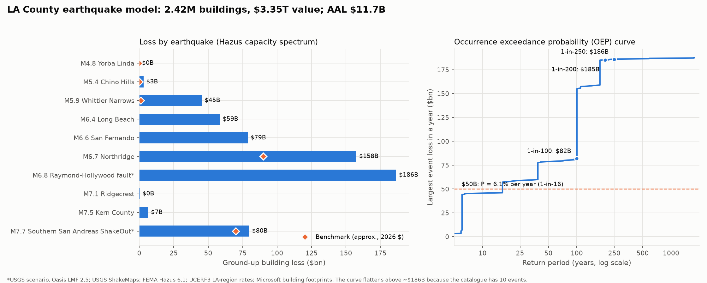

# LA Earthquake Cat Model on Oasis

An earthquake catastrophe model for Los Angeles County, built on the open-source
[Oasis Loss Modelling Framework](https://oasislmf.org). It takes USGS ShakeMaps for ten
earthquakes, FEMA Hazus 6.1 damage functions, 2.4 million Microsoft building footprints and
USGS UCERF3 earthquake rates, and turns them into loss estimates for LA. Everything runs in
Docker.

The full write-up, with results, validation, sensitivity and limitations, is in
[docs/REPORT.md](docs/REPORT.md).



## Results

Ground-up building loss for 2.42M buildings worth \$3.35T, in 2026 dollars.

| Average annual loss | 1-in-100 | 1-in-200 | 1-in-250 | Chance of a \$50B+ quake in a year |
|---|---|---|---|---|
| \$11.7B | \$82B (on a step, \$80–158B) | \$185B | \$186B | 6.1% |

## Running it yourself

You need a Linux machine with Docker. I used an AWS EC2 `m7i-flex.large` (2 vCPU, 8 GB RAM)
on Ubuntu 24.04 with a 60 GB disk. The default 8 GB EC2 disk is too small, so resize it
before you start.

**1. Get the code onto the machine**

```bash
git clone <this repository> oasis-eq-cat-model
```
```bash
cd oasis-eq-cat-model
```

**2. Install Docker and the Oasis platform**

```bash
bash scripts/step1_setup_oasis.sh
```

This installs Docker, adds some swap, and starts the Oasis platform (about 15 containers)
from Oasis's own OasisEvaluation installer. It finishes with a quick test run of Oasis's demo
model. Log out and back in afterwards so your user can run Docker without `sudo`.

**3. Run the model**

```bash
bash scripts/docker_pipeline.sh
```

The first run takes about 30 minutes, most of it downloading roughly 700 MB of public data and
running the losses. The script does four things in order:

| Stage | What happens | Where it runs |
|---|---|---|
| `build` | Downloads the ShakeMaps and building footprints, then builds the hazard, vulnerability, exposure and earthquake-rate files | Pipeline container |
| `worker` | Adds this model to the Oasis platform as `KrishGupta / LAEQ / 1` | Oasis worker container |
| `run` | Uploads the 2.4M-building exposure and runs the analysis through the Oasis API | Oasis platform |
| `analyze` | Works out the results, charts and sensitivity analysis | Pipeline container |

You can run any stage on its own, for example `bash scripts/docker_pipeline.sh analyze`.

**4. Check the output**

The headline numbers land in `outputs/results/summary.json`, with the charts next to them.
The raw Oasis tables are in `outputs/oasis_run/`, and the sensitivity analysis is in
`outputs/sensitivity/`. If everything matches, you should get the same numbers as above.

To look at the Oasis web UI, open an SSH tunnel from your laptop and go to
`http://localhost:8080` (login `admin` / `password`):

```bash
ssh -i <your-key>.pem -L 8080:localhost:8080 -L 8000:localhost:8000 ubuntu@<ec2-address>
```

## A few notes

- All the data is public. The scripts download it from USGS, Microsoft and the US Census.
- The Hazus tables are already extracted into `data/hazus/csm/`. To re-extract them, download
  the Hazus 6.1 Earthquake Technical Manual from FEMA's website (it blocks scripted
  downloads), put the PDF in `data/raw/hazus/`, and the build stage picks it up.

## What's where

```
scripts/      every step of the model, plus the Docker driver
docker/       pipeline image and the Oasis worker for this model
model/        Oasis keys lookup and model settings
model_data/   hazard footprint, vulnerability, events and simulated years
data/         Hazus tables and the event list (raw downloads are not committed)
outputs/      results, charts, Oasis outputs, sensitivity analysis
docs/         step-by-step notes and the full report
```
